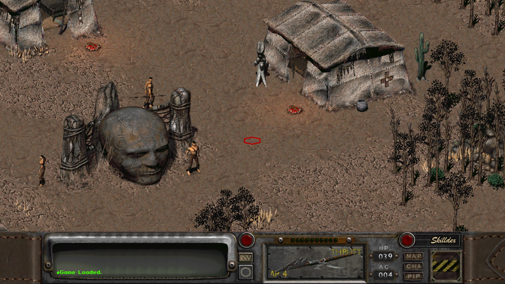
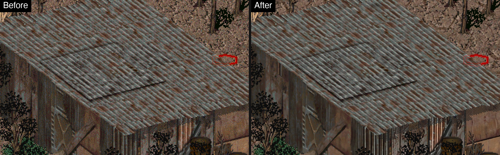
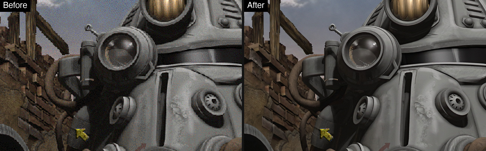
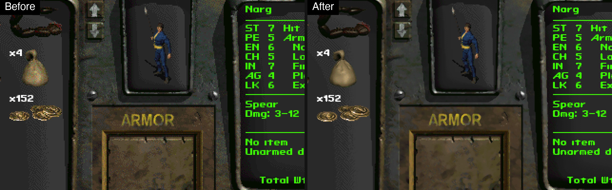
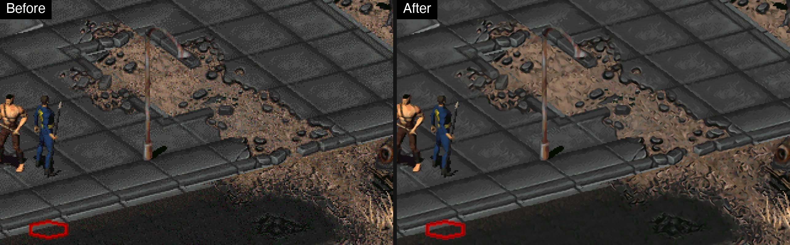
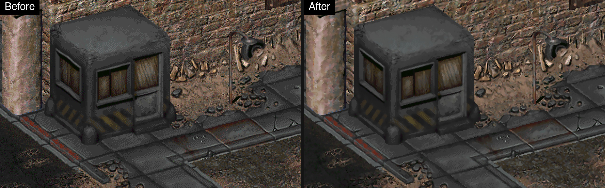
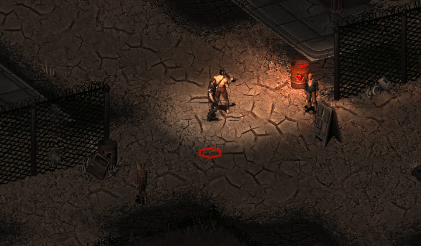
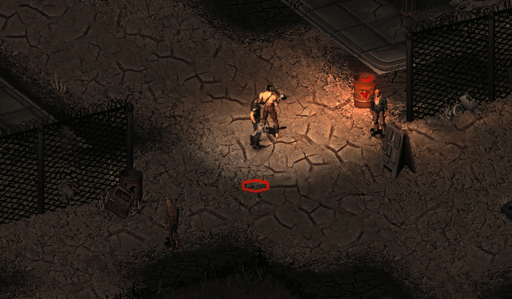
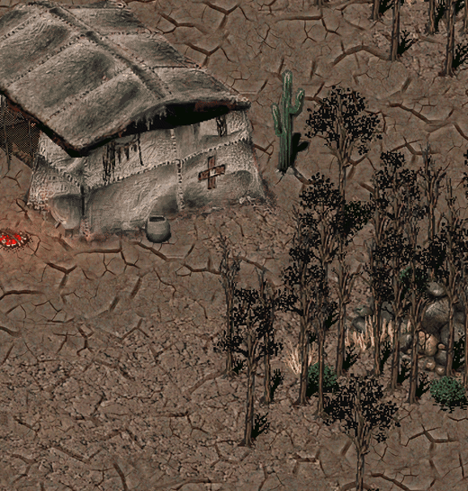
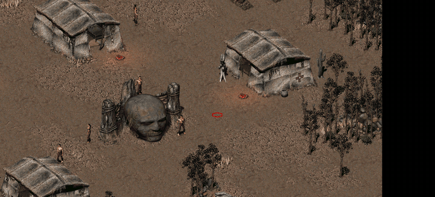

## Fallout 2: Narg Edition

[**Download**](#download)
| [**Installation**](#installation)
| [**Additional mods**](#additional-mods)
| [**Report issues**](#bug-reports)

**Fallout 2: Narg Edition** is Fallout 2 in high definition on a modern engine:

- the [Fallout 2 Community Edition](https://github.com/fallout2-ce/fallout2-ce) engine (CE), which replaces the game's executable, with
- **HD rendering**: true colour at twice the resolution; every picture of the game (interface, floors, roofs, walls, scenery, items, characters, world map) upscaled 2x by the engine from your own copy of the game, with 16-bit colour smoothing; 2x text, coloured lights and soft shadows, a light from every gunshot, trees swaying in the wind, smooth scrolling and map zoom;
- **[Stimpak](https://github.com/lukmusial/fallout2-stimpak)**, a savegame editor on the main menu (character, companions, quests, locations, travel).

It installs on vanilla Fallout 2 and on top of the [Restoration Project](https://github.com/BGforgeNet/Fallout2_Restoration_Project) (RPU), whose own art is upscaled the same way.

**No game art is distributed.** The archives hold the engine, the installer and documentation; the HD pictures are made on your machine, from your game's files, while the game runs. You need your own copy of Fallout 2 ([GOG](https://www.gog.com/game/fallout_2), [Steam](https://store.steampowered.com/app/38410), [Epic](https://store.epicgames.com/p/fallout-2)).

## Screenshots

Each pair shows the same spot before (the original art, as the game draws it at this screen size) and after (Narg Edition, upscaled by the engine), enlarged 2x so single pixels show.

On the Restoration Project, before (RPU's art, as the game draws it) and after (Narg Edition):

In motion: lights that move with the player at night, a light from every round of a burst, trees in the wind, and map zoom.

| Lights | Gunshots |
|---|---|
|  |  |
| **Wind** | **Zoom** |
|  |  |

Stimpak's screens are in [its README](https://github.com/lukmusial/fallout2-stimpak#readme).

### How the HD pictures are made

The engine upscales each picture the first time it is needed, with a deterministic, palette-aware 2x upscale (de-dithering, edge-directed interpolation, gradient restoration and sharpening, run in 16-bit colour so smooth areas lose their banding), on all CPU cores:

- while a map loads, everything it can show at once (floor and roof tiles with their real neighbours on the map, walls, scenery, items, and every character's standing, walking and running animations in all directions), behind a loading screen with a progress bar;
- the world map, town maps and help screens, other elevations and the rest of the characters' animations in idle time;
- the results are kept in `data/hd/cache` (at most 2 GB, oldest removed first), so a second visit to a town loads faster.

After a map has loaded nothing is upscaled while you play. On an Apple M5 Pro a town takes 0.2-0.8 s to prepare the first time and 0.1-0.3 s with the cache; play runs at the 60 fps limit.

## Download

Releases are archives per platform: `narg_v<version>_macos.zip`, `narg_v<version>_linux.zip`, `narg_v<version>_windows.zip` (see [the changelog](docs/changelog.md)). Each holds:

| File | What it is |
|---|---|
| `Fallout 2 Narg Edition.app` (macOS), `narg/linux/fallout2-ce`, `narg/windows/fallout2-ce.exe` | the engine |
| `narg/rpu-save-convert.py` | converts saves from the unmodded game for the Restoration Project ([RPU notes](docs/rpu.md)) |
| `narg/narg.cfg` | the settings the installer puts into `fallout2.cfg` |
| `narg/settings/*.cfg` | optional settings components (see below) |
| `narg/f2_res.dat` | hi-res interface art, installed when the game has none |
| `narg-install.sh` / `.command` / `.bat` | the installer |
| `narg/docs/` | this documentation |

## Installation

- Narg Edition installs on **vanilla Fallout 2** (GOG, Steam, CD) or on **Fallout 2 with RPU** (install RPU first, then Narg Edition).
- Saved games keep working. Saves from before RPU load on RPU after `narg/rpu-save-convert.py` ([RPU notes](docs/rpu.md#saves-from-before-rpu)).
- Everything the installer replaces or changes is copied to `backup/narg/` first.

Per platform: [macOS](docs/macos.md) | [Linux](docs/linux.md) | [Windows](docs/windows.md) | [on top of RPU](docs/rpu.md).

In short: extract the archive into the game folder, run `narg-install.command` (macOS), `narg-install.sh` (Linux) or `narg-install.bat` (Windows), then start the game with `Fallout 2 Narg Edition.app` / `fallout2-ce` / `fallout2-ce.exe`.

### Options

| Option | Effect |
|---|---|
| `--with no_wind` | trees and bushes stand still |
| `--with no_shot_light` | no light from gunshots and explosions |
| `--with no_lights` | no coloured lights, glow or soft shadows (for slow machines) |
| `--with pixel_doubled` | HD output with the original art pixel-doubled instead of upscaled (no upscaling work) |
| `--with classic` | the original 256-colour look; engine, Stimpak and fixes stay |
| `--with windowed` | a window instead of full screen |
| `--resolution 2560x1440` | screen size, instead of the detected one |

All of them are settings in `fallout2.cfg` (`[graphics]`, `[screen]`) that you can change later. On Windows the options are written `-With no_wind,windowed -Resolution 2560x1440`.

### Compatibility with content mods

The engine upscales whatever picture the game draws, so art a mod replaces or adds (RPU's world map, new locations, tiles, items, the hi-res main menu) is upscaled like the game's own. See [RPU notes](docs/rpu.md).

## Additional mods

### Included

- [Fallout 2 Community Edition](https://github.com/fallout2-ce/fallout2-ce) engine at c30f1efc
- [Stimpak](https://github.com/lukmusial/fallout2-stimpak) savegame editor
- HD rendering and the in-engine upscale (this project)

### Recommended

- [Restoration Project](https://github.com/BGforgeNet/Fallout2_Restoration_Project) (tested with v2.4.34)
- the sfall mods CE supports, e.g. [FO2tweaks](https://github.com/BGforgeNet/FO2tweaks), [Inventory Filter](https://github.com/rotators/InventoryFilter)

## Bug reports

Describe the problem, attach a savegame and a screenshot (in HD, F12 saves a full-resolution PNG), and say whether RPU is installed.

## Additional info

- [Changelog](docs/changelog.md)
- [Known issues](docs/known.md)
- [Credits and licences](docs/credits.md)
- [Development: building the engine and the archives](docs/development.md)
- [Test results](docs/testing.md)
